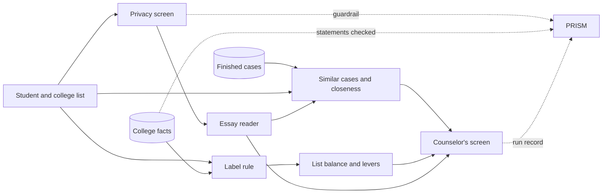

# Counselor Copilot

**We turn a student's college list into a checkable reach, target and likely picture grounded in real outcomes,
and we flag what we do not know.**

Counselor Copilot is a meeting tool for college counselors. You load a student and their list, and it labels each
school reach, target or likely using the college's published admit rate and score band, then shows what happened to
similar finished cases. It never invents a personal chance of admission. If the evidence is thin, the list has no
likely school, or a result comes from a biased public pool, it says so. Essays are read only for themes after
personal details are masked, and an essay never moves a label. A counselor can check every claim against the case
counts and the Common Data Set in the room, without a walkthrough.

Built in one day at the Get Hired Hack (Columbia Startup Lab, October 10, 2026) for the track *The Counselor
Copilot*. Theme: "AI You Can Trust."

**Demo video:** [docs/video/counselor_copilot_demo.mp4](docs/video/counselor_copilot_demo.mp4)

| | |
|---|---|
|  |  |
|  |  |

## What a counselor sees

One story in four chapters, each ending in one obvious next step.

1. **Who you are.** What stands out in the student: their activities, the themes of their essay, and two
   sentences in their own words.
2. **Where you stand.** One picture of the whole list. The student is a line; each college is a bar showing where
   the middle half of its students scored, with the distance written on it ("70 points above your score") and a
   reach, target or likely label. The same list can be viewed as rings or as a map.
3. **What is in your hands.** Colleges that would balance the list, a "what if the score were..." slider that
   re-labels the list as it moves, and what each college says it looks for beside what is in the profile.
4. **Your plan.** Five things to do this month, a sheet to print for the family, and a status for each college.
   When a result comes in, it becomes a finished case for next year's students, with no names.

Pressing a college opens the detail:

- **How we got this:** the rule and the published numbers behind the label.
- **Who you resemble:** whether the student sits closer to the people admitted there or the people who were not,
  part by part, beside the nearest cases of each. The counselor's own school and public posts are kept apart.
- **What could change it,** and **what the college says** in its own Common Data Set.

One switch, **Show the working**, reveals every source, rule, check and step for the counselor or anyone
auditing the result.

## Why there is no percentage

Public outcome data comes from people who chose to post their results. We measured it: across the colleges in
that data, posters reported being admitted a median of about 2.8 times as often as applicants really are. A tool
that turned that pool into "your chance" would be telling a hopeful family something untrue.

So the product holds to three rules:

- **Code sets every label, count and number. A model only reads.** The single model call reads the essay and
  returns themes and notes. Each note must carry a word-for-word quote, and code drops any note whose quote is not
  in the essay.
- **"Not sure" is a normal answer.** "Can't say" when a college publishes no score range. "Too few cases to say
  anything yet" under 15 cases. "Outside our data" for a college not in the file. "This one is close" when 30
  points would change a label.
- **Cases are shown as cases.** Counts of admitted, not admitted and waitlisted, always with how many, always
  beside the official admit rate, and always with a note on who posts.

## How it works



| Part | What it does | Where |
|---|---|---|
| Label rule | Reach, target or likely from the college's admit rate and score band; re-run at 30 points either way to say when a label is close | `engine/labels.py` |
| Similar cases | Finished cases like this student, counted by a written rule, in two pools that are never merged | `engine/cases.py`, `engine/caselog.py` |
| Closeness | How much the student resembles the admitted and the not-admitted group at each college, part by part, with a check of how that held up on 400 past cases | `engine/similarity.py`, `docs/req/` |
| Applicant evidence | A store for applicant records with provenance and consent, intake from messy files, and a weighted similarity score that reports how much of a profile could be compared. Its scorer orders the example cases | `admissions/`, `engine/evidence_adapter.py` |
| List balance and levers | Warnings for a lopsided list, suggested colleges, the score at which each label changes, what each college says it reads | `engine/balance.py`, `engine/pipeline.py` |
| Privacy screen | Masks names, addresses, phone numbers and schools; stops text written to steer an AI; if the check cannot run, the essay is not read | `engine/privacy.py` |
| Essay reader | Themes and quoted notes from the masked essay, through the Nicrron gateway | `engine/reader.py`, `engine/nicrron.py` |
| College statements | What each college says it weighs, with a source for every sentence | `engine/claims.py` |
| Record and checks | Guardrail, knowledge-base check and run record through PRISM | `engine/prism.py` |
| Screen | Plain HTML, CSS and JavaScript with inline SVG; no framework and no build step | `web/` |

The shape of the result every part reads and writes is in [`CONTRACT.md`](CONTRACT.md).

### What it does, feature by feature
<!-- FEATURES_START -->
Generated from `docs/features.json` by `tools/sync_features.py`; the About page shows the same list. 28 of 31 work today.

| Feature | What it does | Where | Status |
|---|---|---|---|
| **One story in four chapters** | Who you are, where you stand, what is in your hands, your plan. Each chapter ends in one obvious next step; a waypoint bar tracks where the reader is. | The whole screen after "Show where they stand". | Works |
| **Reach / target / likely label** | Each college gets a label from a written rule in code, from its published admit rate and middle score range. Never from a model. | Chapter 2; tap a college, "How we got this". | Works |
| **This one is close, and publishers disagree** | Every label is rerun with the score 30 points either way and the admit rate 5 points lower; a label that flips is marked. Five published rulebooks are run on the same score and any disagreement is shown. | Chapter 2 and "How we got this". | Works |
| **Where you stand: the trail map** | Every college's middle score band on one line, the distance to the student's score written on each bar, and a label beside it. | Chapter 2. | Works |
| **Example cases, two pools kept apart** | Counts of admitted, not admitted and waitlisted among finished cases like this student, with n and the official admit rate beside them. The school's own cases and the public self-reported pool are never added together, and the public pool's over-count is stated. | Tap a college, "Who you resemble". | Works |
| **Who you resemble: closer to the admitted or the not admitted** | Per college, the distance from the student to the 7 nearest admitted and the 7 nearest not-admitted cases, over score, activities rating, major group, hooks and residency. A lean, a steady test, the parts that are close or far, and the nearest cases of each. A distance, never a percentage; the label is untouched. | Tap a college, "Who you resemble". | Works |
| **Rings picture** | The student at the centre, one dot per college as far out as the student is from the people admitted there. Hollow when there are too few cases; on an outer ring when it cannot be placed. | Chapter 2, "Other pictures: Rings". | Works |
| **Map picture** | The student in the middle, a branch per label, a node per college, and under each college its nearest kind of admitted student and its three nearest admitted cases. | Chapter 2, "Other pictures: Map". | Works |
| **Scatter, part bars, kinds and changes** | A scatter of that college's cases by score and activities rating with the student as a star and the three kinds' medoids ringed; a bar per part; three kinds of admitted student found by k-medoids and named from counts; and what would bring the student closer (score, activities, a named major; never hooks, home state or GPA). | Tap a college, "Who you resemble". | Works |
| **Essay and activity text in closeness** | With a model key, masked essay and activity text are embedded and become two more parts of the distance, compared only where both profiles have text. Vectors stay in memory. Without a key the structured parts carry the comparison. | Tap a college, "Who you resemble", with the working shown. | Works with a key |
| **Activities rating input** | A 0 to 10 dial for the counselor's own rating of the student's activities, used only by closeness. | Counselor tools, "Change the details". | Works |
| **What the college says it weighs** | Statements from each college's own Common Data Set form, each with its field, year and source link, checked in code and confirmed against a knowledge base. Common beliefs are checked against the form. | Tap a college, "What the college says". | Works |
| **What the college looks for, beside the profile** | For each factor the college says it reads, whether it is in this profile, not yet, or cannot be seen here. Three neutral states and no total: it is not a score. | Chapter 3. | Works |
| **List balance and suggested fills** | Warnings when a list is reach-heavy, has no likely or no target, piles onto very selective colleges, or is short. Suggested colleges that would be likely or target, preferring the home state. | Chapter 2 headline and caution; chapter 3. | Works |
| **"What if the score were…" slider** | Moves the student's score and re-labels the whole list as it moves, saying which colleges change at which score. Labels only; nothing else is re-run. | Chapter 3. | Works |
| **Cost: sticker price and what families paid** | The published sticker cost beside the federal average paid after grants, by income band when given. One family's price can differ, and the screen says so. | Chapter 3 and each college. | Works |
| **Your plan, and a sheet to print** | Five things to do this month from the list and its gaps, and a one-page print layout for the family in plain words. | Chapter 4. | Works |
| **Keep track, and pay it forward** | A status for each college (considering, applying, submitted, result). When a result comes in it becomes a finished case for next year's students, with no names. | Chapter 4. | Works |
| **Essay notes with quotes, after masking** | Names, addresses, phones and dates are masked, then one model reads the essay and returns observations with word-for-word quotes; code drops any note whose quote is not in the essay. A second model tags the major independently. An essay with instructions aimed at an AI is stopped twice. | Chapter 1; Counselor tools, "Questions to ask". | Works with a key |
| **Show the working** | One switch reveals every source, rule, check and step behind the screen: the five steps, what code did and what a model did, sentences hidden by checks, the privacy record, and the closeness check table. | The switch in the header. | Works |
| **About, and How we worked this out** | A tour with live buttons; the parts and weights, the algorithm as a diagram, the libraries, the choices made, every data source with what was taken from it, and this feature list. Weights and thresholds are read from the engine, not typed into the page. | "About" in the header; Counselor tools, "How we worked this out". | Works |
| **Add a finished case** | A counselor records a finished case for the school's own pool. Anything that looks like a name, email, phone or date of birth is refused. | Counselor tools, "Add a finished case". | Works |
| **No personal chance of admission** | The screen never shows a percentage for the student. Asking why gets the measured over-count of the public pool and a pointer to the evidence instead. | "Why there is no percentage" in chapter 2; every count sits beside the official admit rate. | Works |
| **Holds-up check for closeness** | 400 past posters, each hidden in turn, their lean computed and their real outcome counted. Shown as counts with the caveat about self-reporting. | Show the working; python -m engine.similarity --check | Works |
| **Applicant-evidence package** | A store for applicant records with provenance and consent, intake from messy files, and a weighted similarity score that reports how much of a profile could be compared. Its scorer orders the example cases. | Behind the example cases; admissions/README.md | Works |
| **1,339 colleges from the federal file** | The full Scorecard institution file with cost and net price, and a "did you mean" for a college typed slightly wrong. | Everywhere a college is named. | Works |
| **Shared preview with no server** | Saved runs for the demo students, with the what-if scores, as plain files that open from a folder or a zip. | `python tools/make_static.py --zip` | Works |
| **Tests and the acceptance sheet** | Automated tests with no network, including one that fails if the fixture or this feature list drifts from its copies. 60 labels worked out by hand from the published rows, separately from the label code: 60 of 60 match. | `python -m unittest discover -s tests -t . ; python tests/acceptance/run_acceptance.py` | Works |
| **Parser for raw public posts** | Turns raw r/collegeresults posts into a wider pool (654 colleges in our run). Not wired in; its output stays out of the repository because it holds snippets of people's posts. |  | Thin |
| **PRISM Evaluator on the essay notes** | The run's score is read back in code instead. |  | Not done |
| **Several intended majors in the form** | Closeness can try another major the student named, but the form sends only one; the API accepts major_interests. |  | Not done |
<!-- FEATURES_END -->

### Sponsor tools

- **Nicrron** carries the essay reader. One fast model reads the essay; a second model from a different maker
  independently tags the intended major, and code uses the tag only when the two agree.
- **PRISM by Block Convey** does three jobs. A guardrail on the essay: one screening call through PRISM's proxy,
  so an essay with hidden instructions is blocked before any model reads it. A Knowledge Base that every college
  statement is checked against: a false statement we planted came back "not confirmed". And a record of every
  model call and the five steps of each run (retrieve, score, bucket, explain, log). Setup notes:
  [`docs/PRISM_SETUP.md`](docs/PRISM_SETUP.md).

## Run it

Python 3.12 or later. Standard library only: nothing to install.

```bash
python server.py
```

Open http://localhost:8765/ and choose one of the nine invented demo students. With no keys set, everything works
except the essay reader.

Optional settings are read from environment variables. No key is stored in this repository.

| Variable | What it switches on |
|---|---|
| `NICRRON_API_KEY` or `NICRRON_KEY_FILE` | The essay reader |
| `PRISM_API_KEY` or `PRISM_KEY_FILE`, with `PRISM_PROJECT_ID` and `PRISM_SEND=1` | The run record, the knowledge-base check and the guardrail |
| `ANTHROPIC_API_KEY` or `ANTHROPIC_KEY_FILE` | The screening call through PRISM's proxy, which is what lets the guardrail block |
| `SIMILARITY_PLUGIN` or `SIMILARITY_URL` | A different similarity tool for ordering examples (see [`docs/INTEGRATING_A_TEAMMATE_TOOL.md`](docs/INTEGRATING_A_TEAMMATE_TOOL.md)) |
| `PORT` | The port (default 8765) |

To share the screen as plain files with no server behind it:

```bash
python tools/make_static.py --zip
```

That saves real runs for the demo students into `dist/`.

## How we know it is right

```bash
python -m unittest discover -s tests -t .
python tests/acceptance/run_acceptance.py
```

- **348 automated tests,** none of which touch the network, including one that fails if the embedded fixture or
  the feature list drifts from its source file.
- **60 of 60 on an independent answer sheet.** Sixty labels were worked out by hand from the published rows,
  separately from the label code (`tests/acceptance/`).
- **Whole-system checks** run with the answer sheet: no result contains the language of odds; a pool under 15
  cases is never called enough; labels do not change when the essay changes; an essay with a hidden instruction is
  stopped; personal details in an essay never appear in a result; the same input gives the same answer twice.
- **Outside review.** The code was attacked by reviewers from a different model family, and the screen was judged
  from screenshots by reviewers who had not seen the project. Their findings are fixed or listed below.

## Data

| Data | Real or invented | Source |
|---|---|---|
| 1,339 colleges: admit rates, score ranges, sticker cost, what families paid after grants | Real | US Department of Education, College Scorecard |
| What 24 colleges say they weigh | Real | Each college's Common Data Set, read through collegedata.fyi; fields that failed checks are skipped |
| Public case pool: about 2,250 applicants | Real, self-reported, not verified | Public r/collegeresults posts as compiled in the GitHub repository `shreybirmiwal/college-predictor`. That repository states no licence; the files are here for the demo and can be removed |
| The school's own cases | **Invented** by a seeded script, and labelled as invented on screen | `data/synthetic/SYNTHETIC_school_cases.csv` |
| Demo students and essays | **Invented,** stamped SYNTHETIC | `data/synthetic/` |

`tools/parse_reddit_posts.py` can turn raw public posts into a wider pool (654 colleges in our run). It is not
wired in, and its output is kept out of the repository because it holds snippets of people's posts.

### Essay and activity text in closeness (optional, only with a key)

With a Nicrron key, a live run embeds the masked essay and activity text (`openai/text-embedding-3-small`,
through the existing gateway) and closeness gains two parts: essay content and activity descriptions, compared
only where both profiles have text (`engine/semantic.py`). The public pool has no full essays, so school cases
are compared on their brief `essay_theme` and `activities_note`, and the screen marks those as theme summaries.
Full historical essays can be joined to case ids through `data/cases/essay_corpus.json` (an array of
`{"case_id", "essay", "activities_note"}`); corpus text passes the same privacy mask and instruction check, and
blocked essays are excluded. Vectors stay in a bounded in-memory cache and are never written to disk or sent to the
browser. Without a key, or with `use_model=False`, the text parts are simply absent and the structured parts carry
the comparison. Text distance is not an essay quality score, and the labels never use it.

## Repository layout

```
engine/       the parts listed above, joined in pipeline.py
admissions/   the applicant-evidence package (its own README inside)
web/          the screen
server.py     the local server
tests/        unit tests and the acceptance sheet
tools/        scripts that build data files, the shareable copy, and the knowledge-base pages
data/         college facts, cases, college statements, invented demo data
docs/         the contract's example result, requirements for closeness, setup notes, the demo video
```

## Known limits

- Labels use test scores and admit rates only. The federal file has no GPA field, and the screen says so.
- Closeness uses score, activities rating, major group, hooks and home state (plus GPA for the school's own
  cases, and masked essay and activity text only when a model key is set). Its weights are starting values, not
  tuned. It is a resemblance, never a forecast.
- The public case pool skews toward high scorers, computer science and selective colleges. It is not a national
  sample, and the screen says so wherever it appears.
- The school's own cases are invented for the demo. Real, verified, de-identified cases are the right source.
- The applicant-evidence package's scorer is wired in; its database is not yet the product's store.
- College statements cover 24 of the 1,339 colleges.
- Cost shows the sticker price and the federal average of what families paid after grants. One family's price
  can differ.
- PRISM's Evaluator is not attached yet; the run's score is read back in code instead.
- Privacy masking is rule-based and was hardened after an outside review, but it is not a formal
  de-identification standard. Do not load real student records.
