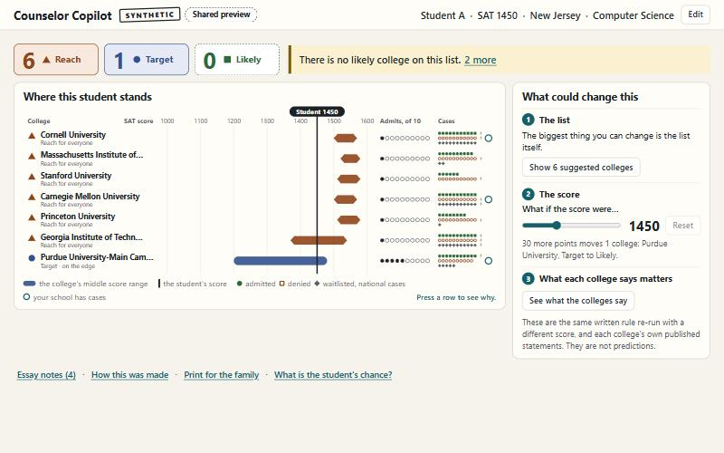
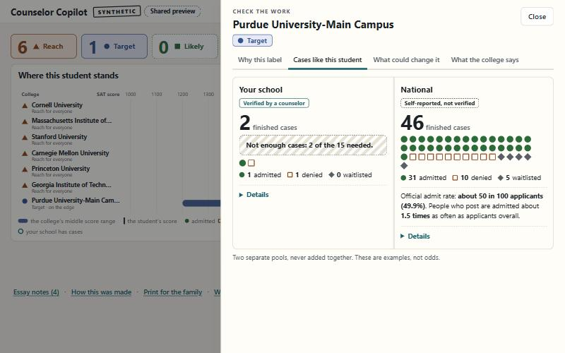

# Counselor Copilot

Built on October 10, 2026 at the Get Hired Hack (Columbia Startup Lab), for the track **The Counselor Copilot**.
Theme: "AI You Can Trust."

**One line:** we turn a student's college list into a checkable reach, target and likely picture grounded in real
outcomes, and we flag what we do not know.

Counselor Copilot is a meeting tool for college counselors. You load a student and their list, and it labels each
school reach, target or likely using the college's published admit rate and score band, then shows what happened to
similar finished cases. It never invents a personal chance of admission. If the evidence is thin, the list has no
likely school, or a result comes from a biased public pool, it says so. Essays are read only for themes after
personal details are masked, and an essay never moves a label. A counselor can check every claim against the case
counts and the Common Data Set in the room, without a walkthrough.

It answers four questions:

1. **What do the published numbers say?** Each college gets a reach, target or likely label, set by a written rule
   in code, never by a model.
2. **What happened to students like this one?** Real finished cases (admitted, denied, waitlisted), with how many
   there are and where they came from. Two pools are kept apart: the counselor's own verified cases, and a national
   pool of self-reported results.
3. **What does the college itself say it weighs?** Statements from each college's own published form, each
   confirmed against a knowledge base.
4. **Is the list balanced, and what could change it?** Warnings when a list is lopsided, suggested fills beyond the
   usual very selective colleges, and a "what if the score were..." slider.

It never gives a personal chance of admission.





## The product so far (1:10 PM, October 10)

**What a counselor sees.** Pick or enter a student and press "Build the list". The first view is deliberately
small: how many colleges are reach, target and likely; the single most important warning; and one picture, "Where
this student stands", with every college's middle score range on a shared line and the student's score drawn
through all of them. Beside it are three levers: the list itself (suggested colleges that would fill the gaps), a
"what if the score were..." slider that re-labels the list as it moves, and what each college says matters.
Pressing a college opens four tabs: why this label, cases like this student, what could change it, and what the
college says. A footer holds the essay notes, how the answer was made, a one-page sheet to print for the family,
and "What is the student's chance?", which explains why no percentage is given and points at the evidence instead.

**What works today.**
- End to end in about six seconds with the essay reader and PRISM switched on.
- 60 of 60 labels match a hand-worked answer sheet; 177 unit tests pass.
- The essay reader runs through Nicrron with two models from different makers.
- PRISM: the guardrail stops an essay with a hidden instruction; college statements come back "confirmed" from the
  Knowledge Base and a planted false one "not confirmed"; each run and its five steps are recorded.
- A version that needs no server (`tools/make_static.py`) for sharing a link.

**What is not done.**
- PRISM's Evaluator is not attached to the essay reader's output yet.
- The school's own "verified" cases are invented demo data; real ones would come from a counselor or from Nerd Apply.
- Matching on essays and activities is thin, because the public case file has no essay text.
- Nobody outside the builders has reviewed the print sheet, dark mode or phone width.

## How it handles accuracy and uncertainty

- **Code sets every label, count and number.** The only model call reads the essay and returns themes and notes.
  Every note must carry a word-for-word quote; code drops any note whose quote is not in the essay.
- **"Not sure" is a normal answer.** The screen says "Can't say" when a college publishes no score range, "Not
  enough cases: 4 of the 15 needed" when the sample is small, "Outside our data" for a college not in the file,
  "on the edge" when 30 points would change a label, and "publishers disagree" when published rulebooks differ.
- **No odds.** Counts of similar cases are shown as counts, beside the official admit rate. People who post their
  results are admitted far more often than applicants overall (we measured a median of about 2.8 times), so the
  screen shows that over-count and tells the reader to treat the cases as examples.
- **Privacy first.** Names, addresses, phone numbers and schools are masked before any model reads an essay. An
  essay containing instructions aimed at an AI is stopped twice: by our own check, and by PRISM's guardrail.
- **Checked by an independent answer sheet.** 60 labels worked out by hand from the published rows by a builder who
  did not see the label code: 60 of 60 match. Run it: `python tests/acceptance/run_acceptance.py`.

## Run it

Python 3.12, standard library only. No installs.

```bash
python server.py
```

Then open http://localhost:8765/ . Without any keys everything except the essay reader works.

Optional settings, all read from environment variables (no key is ever stored in this repository):

| Variable | What it switches on |
|---|---|
| `NICRRON_API_KEY` or `NICRRON_KEY_FILE` | The essay reader, through the Nicrron model gateway |
| `PRISM_API_KEY` or `PRISM_KEY_FILE`, plus `PRISM_PROJECT_ID` and `PRISM_SEND=1` | Recording each run in PRISM, the knowledge base check, and the guardrail |
| `ANTHROPIC_API_KEY` or `ANTHROPIC_KEY_FILE` | The one screening call through PRISM's proxy, which lets the guardrail block |
| `PORT` | The port (default 8765) |

Tests: `python -m unittest discover -s tests -t .` (230 tests, no network).

To share the screen as plain files with no server: `python tools/make_static.py --zip` saves real runs for the six
demo students into `dist/`.

## Sponsor tools

- **Nicrron** carries the essay reader: one fast model reads the essay; a second model from a different maker
  independently tags the intended major, and code uses the tag only when the two agree.
- **PRISM by Block Convey**: a guardrail on the essay (prompt injection, through PRISM's proxy); each college
  statement is confirmed against PRISM's Knowledge Base, and a false statement comes back "not confirmed"; every
  model call and the five steps of a run (retrieve, score, bucket, explain, log) are recorded. See
  `docs/PRISM_SETUP.md`.

## What is real and what is invented

| Data | Real or invented |
|---|---|
| 1,339 colleges: admit rates, score ranges, sticker cost, and what families paid after grants (`data/colleges/`) | Real. US Department of Education, College Scorecard. |
| What 24 colleges say they weigh (`data/cds/`, `data/kb/`) | Real. Each college's Common Data Set, read through collegedata.fyi; fields that failed checks are skipped. |
| National case pool (`data/cases/`) | Real, self-reported. Public r/collegeresults posts as compiled in the GitHub repository shreybirmiwal/college-predictor. No names. That repository states no licence; the files are included for the demo and can be removed. |
| The school's own cases (`data/synthetic/SYNTHETIC_school_cases.csv`) | **Invented**, generated by a seeded script. Stamped SYNTHETIC. |
| Demo students and essays (`data/synthetic/`) | **Invented.** Stamped SYNTHETIC. |

## Layout

`engine/` the parts (labels, cases, balance, privacy, reader, claims, prism, pipeline) · `web/` the screen ·
`server.py` the local server · `tests/` unit tests and the acceptance sheet · `CONTRACT.md` the data shape every
part agreed to before building · `docs/` setup notes and an example result.

## Known limits

- Labels use test scores and admit rates only. The federal file has no GPA field, and the screen says so.
- Similar-case matching uses score, major group and hook status. Essay themes only reorder the school's own cases.
- College statements (Common Data Set) cover 24 of the 1,339 colleges.
- Cost shows the sticker price and the federal average of what families paid after grants. One family's price can differ.
- PRISM's Evaluator is not attached yet; the run's score is read back in code instead.
